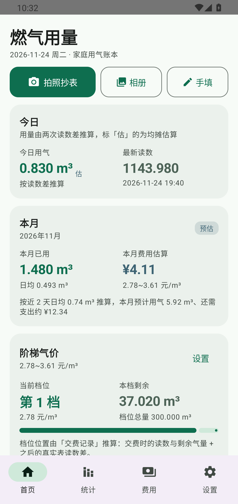
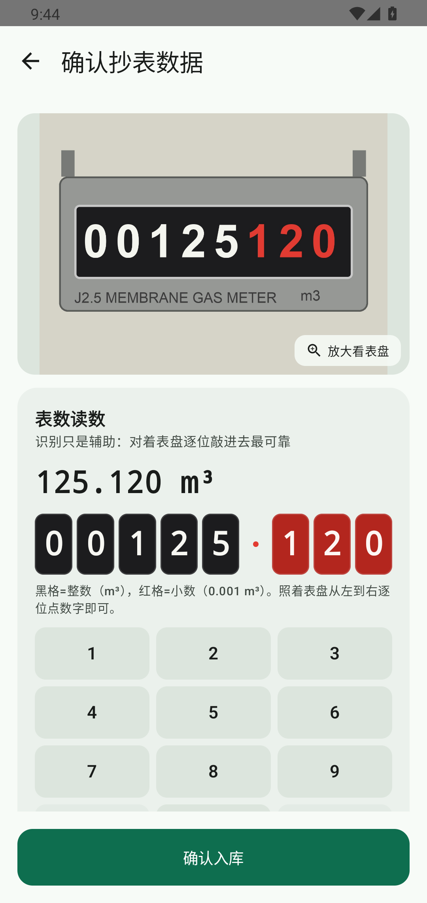
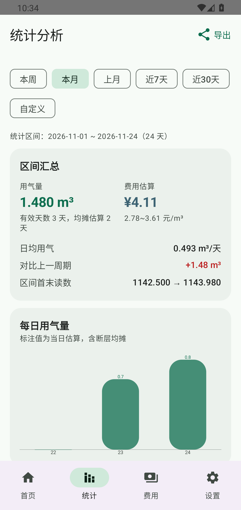
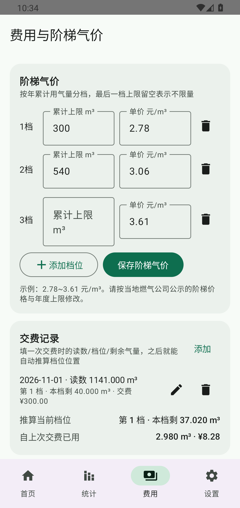

# 家用燃气记录（Android）

记录家里燃气表读数、推算每天／每月用气量，并按阶梯气价估算费用。
拍照或从相册导入照片即可开始记录：App 会离线识别表数、读取照片的拍摄时间与位置，并自动补上拍摄地点当天的气温区间。

> 全部数据只存在手机本地；联网仅用于查询历史气温和地名。

| 首页 | 抄表确认 | 统计分析 | 费用与阶梯 |
| --- | --- | --- | --- |
|  |  |  |  |

## 功能

**抄表**
- 相机拍摄（带取景框、手电筒）或系统相册选图，也可从其它 App「分享」图片进来
- 离线 OCR 识别表数（ML Kit，模型随 APK 打包，不联网也能识别）
- 自动读取照片 EXIF 的拍摄时间、GPS，并反查地名
- 自动查询拍摄地点当天的最高/最低气温（Open-Meteo 历史天气）
- **逐位抄表输入器**：照表盘 5 位黑字 + 3 位红字逐格输入，识别不准时手动订正最快
- 重复读数、读数回退、「比上次多/少多少」都会在入库前提示

**统计**
- 按天／本周／本月／上月／近 7 天／近 30 天／自定义区间统计用气量
- 每日用气柱状图、当日气温折线、气温与用气相关系数
- 逐日明细表（标注「精确」＝同日多次读数差，「估算」＝跨天均摊）
- 区间费用估算与跨档明细、与上一周期对比、CSV 导出

**费用**
- 自定义阶梯气价（档位数、每档年度上限、每档单价）
- 交费记录：交费时读数 / 所在档位 / 本档剩余气量
- 由交费记录 + 之后的真实表读数「重放」出当前档位与本档余量
- 区间费用按阶梯逐段计算；月度预测、进入下一档的天数预警
- 年度累计用气量与档位预警

**其它**
- 每周抄表提醒（本地通知，这周已抄表则不打扰）
- 完整备份 JSON 导出／导入、CSV 导出、一键清空
- 深色模式、异常提示（用量尖峰、读数回退、长时间未抄表）

## 安装

```bash
# 需要 JDK 17 + Android SDK（compileSdk 34）
export JAVA_HOME=/path/to/jdk17
export ANDROID_HOME=/path/to/Android/sdk

./gradlew :app:assembleDebug          # 产物：app/build/outputs/apk/debug/app-debug.apk
adb install -r app/build/outputs/apk/debug/app-debug.apk
```

也可以用 Android Studio 直接打开本目录运行。工程内自带一份 debug 证书（`keystore/debug.keystore`，口令 `android`），release 也用同一份签名，方便自用安装。

## 目录

```
app/src/main/java/com/family/gaslog/
├── data/               本地存储（JSON 文件，原子写入）、设置、仓库
│   ├── store/          实体与 GasStore（读写 data/files/gaslog_data.json）
│   ├── GasRepository.kt
│   └── SettingsRepository.kt
├── domain/             纯 Kotlin 业务逻辑（可单测，不依赖 Android）
│   ├── Units.kt        单位与格式化（读数 0.001 m³ / 金额分）
│   ├── UsageCalculator.kt  逐日用量推算、区间汇总、相关性
│   ├── CostEngine.kt   阶梯气价核算
│   ├── BillingReplay.kt 交费记录 → 当前档位重放
│   └── Insights.kt     异常检测与月度预测
├── service/            照片、OCR、天气、提醒
└── ui/                 Compose 界面
```

## 关键约定

- 表数按 **0.001 m³** 的整数（milli-m³）保存，金额按 **分** 保存，避免浮点误差。
- 用气量推算规则：同日多次读数→精确差值；跨天读数→按天数均摊（界面标注「估」）；读数回退→按换表处理。
- 费用永远从「某时刻的阶梯位置」出发逐段累加，阶梯位置由交费记录 + 真实读数推进得到，估算只影响用气量、不影响单价。

## 测试

```bash
./gradlew :app:testDebugUnitTest        # 15 个用例：用量推算、阶梯计费、解析
# 真机/模拟器上的 OCR 回归（照片放到 /sdcard/Android/data/com.family.gaslog/files/ocr/）
adb shell am instrument -w -e class com.family.gaslog.OcrBenchTest \
    com.family.gaslog.test/androidx.test.runner.AndroidJUnitRunner
adb logcat -d -s OcrBench
```

`testdata/` 里有合成的表盘测试图（`meter_*.jpg`）与你提供的真实表具照片（`real/`），用于回归识别效果。

## 跳过抄表日的处理

故意几天不抄表时（例如出门），两条读数之间的用量要分摊到中间每一天：

- 每天的**气温与抄表无关地单独拉取并缓存**（`daily_temps` 缓存，按日期+位置），所以缺口日也有气温、也能进图表和采暖度模型；
- 分摊权重**要么整段用温度模型、要么整段按时长均分**，不会出现"缺气温的那天权重 1、有气温的那天权重 8"这种混合基准
  （这正是之前跳过一天后某天被压成 1.7 m³ 的原因）；
- 缺口日在逐日表里标「—」，表示当天没有读数、用量是分摊估算。

## 气温数据说明

气温来自 Open-Meteo 的**全球天气模式在拍摄坐标处的网格值**（不是气象站实测，也不是手机自带天气的数据）。
坐标来自照片 EXIF 或设置里的家庭位置；用宁波 2026-11-19~25 与宁波栎社机场站（ZSNB）实测对照：

| 日期 | 本 App（模型网格值） | 机场站实测 | 差值 |
| --- | --- | --- | --- |
| 11-19 | 6.6~13.3 | 7~13 | −0.4 / +0.3 |
| 11-20 | 5.1~13.1 | 5~13 | +0.1 / +0.1 |
| 11-21 | 4.5~15.1 | 3~16 | +1.5 / −0.9 |
| 11-22 | 5.1~16.9 | 3~18 | +2.1 / −1.1 |
| 11-23 | 9.4~20.0 | 10~19 | −0.6 / +1.0 |
| 11-24 | 6.6~13.9 | 5~14 | +1.6 / −0.1 |
| 11-25 | 3.6~12.2 | 3~12 | +0.6 / +0.2 |

结论：数据源正确、定位正确，误差在 1~2℃ 量级；手机自带天气多为本地气象站/城市预报（且是预报值，冷空气过程里与实际最低温能差 4~6℃），
两者本就不会逐度一致。需要更贴近本地气象台时，可在确认页「手动填写气温」覆盖。

## 已知限制

- OCR 对反光、逆光、表盘很小或滚轮正处于两个数字之间的照片会漏位/错位。App 的取舍是：**识别只做预填，最终以你核对的读数为准**，并提供放大看图 + 逐位输入。
- 跨天用量是均摊估算，抄表越规律（最好每天固定时间一次）越准确。
- 历史气温依赖网络；无网时可手填，或稍后重试。
- 阶梯气价是通用模型（年度累计分档），各地「年度」起止、价格可能不同，请按当地公示修改。

## 后续可做

- 多表位/多套房管理；表具更换（换表）流程化
- 抄表照片自动对焦/自动裁切表盘区域，红字单独识别
- 费用账单对账（导入燃气公司账单 PDF/截图比对）
- 用气异常预测（漏水/漏气嫌疑）与家人共享（家庭多设备同步）